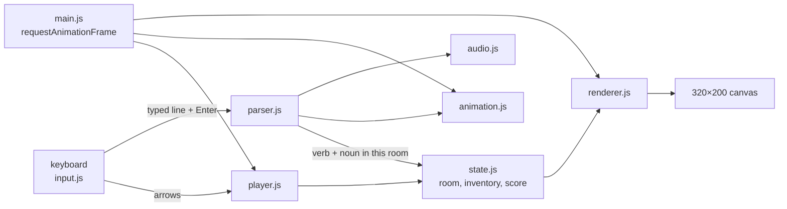

# How Cat's Quest is built

A static site in the style of 1980s Sierra adventure games: a 320 × 200 canvas in the 16-color EGA palette, a
walking character and a typed-command parser. Plain scripts, no framework, no bundler, no runtime dependencies,
and no image files: every room, sprite and letter is drawn in code. About 2,400 lines of game code.

## Runtime

| Piece | What it uses |
|---|---|
| Graphics | **Canvas 2D** at 320 × 200, scaled up with `image-rendering: pixelated`; drawn with `fillRect` |
| Font | Its own 5 × 7 pixel font, stored as bit strings (`font.js`) |
| Sound | **Web Audio API**: square-wave beeps and jingles from `OscillatorNode`s, no sound files |
| Game loop | `requestAnimationFrame`: update the player, step animations, redraw |
| Libraries | None at runtime |

Dev only: Playwright + axe-core (browser and accessibility tests). The game's logic tests run inside the browser.

## Files

Plain scripts sharing globals, loaded in dependency order by `index.html` (and in the same order by `test.html`):

```
js/constants.js   canvas size, floor line, the EGA palette
js/audio.js       sound effects and the fanfare (oscillators)
js/font.js        the pixel font
js/collisions.js  per-room collision boxes (furniture the cat walks around or onto)
js/animation.js   scripted cat animations (sleep, jump, stretch…) that play over frames
js/state.js       game state: room, inventory, score, message boxes, UI mode
js/rooms.js       room descriptions and the objects in each room
js/player.js      the cat: walking, layers (floor, furniture), changing rooms
js/parser.js      the command parser: verb aliases, nouns per room, responses, scoring
js/renderer.js    draws the three rooms, the cat, the text line, message boxes and inventory
js/input.js       keyboard: arrows to walk, typing, Enter, Tab, Escape
js/main.js        the loop
js/tests.js       the in-browser test suite (about 200 checks), run by test.html
```

## How it fits together



## Core techniques

- **Parser.** A typed line is lowercased and split; two-word verbs are tried first ("look at"), then one-word.
  Each verb has a list of aliases (`examine`, `inspect`, `study`… all mean LOOK), and nouns are matched against
  the objects in the current room. System commands (HELP, INVENTORY, SCORE, RESTART) come first; commands are
  ignored while an animation plays.
- **Rooms in code.** Each room is a draw function of `fillRect` calls in palette colors, with dithered patterns
  done by hand. Collision boxes let the cat stand on furniture (it has a layer: floor or furniture).
- **Sound in code.** Effects are short oscillator sequences scheduled on the audio clock; the context starts on
  the first key press, as browsers require.
- **Tests that play the game.** `tests.js` silences sound, then drives the real game through its functions:
  verb matching, every room's nouns, item pickups, scoring, animations, room changes. `test.html` shows the
  results (and previews animations); Playwright opens it and fails if any check fails.

## Testing and deploy

- `npm run test:e2e`: Playwright at desktop and phone size: plays a few commands, runs the in-browser suite
  through `test.html`, and checks accessibility with axe. Game state is global, so tests run one at a time.
- Pushing to `main` runs them in GitHub Actions (the shared workflow in
  [csciuto/app-template](https://github.com/csciuto/app-template)); only if they pass is the site stamped with a
  version and published to GitHub Pages.

## Known limits

- Three rooms: short by design.
- Needs a physical keyboard: there are no touch controls, so it isn't playable on a phone.
- Shared globals keep it simple but mean modules can't be tested in isolation in Node.
